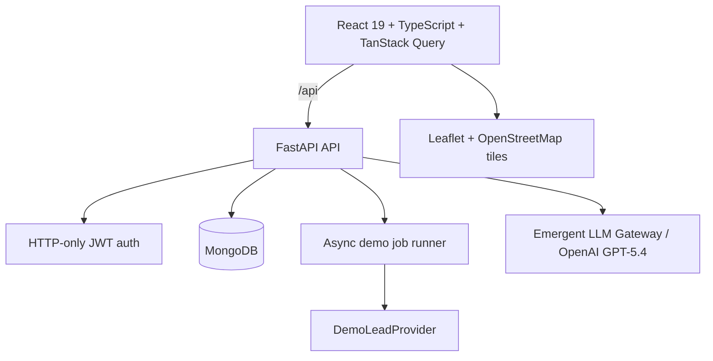

# LeadForge

LeadForge is a production-style B2B prospecting workspace for company and person management, safe data imports, lead discovery, personalized AI outreach, enrichment, validation, lists, asynchronous demo scraping jobs, credits, analytics, and CSV exports.

## Features

- Secure registration and login with password hashing and HTTP-only JWT session cookies
- Dark responsive SaaS dashboard with metrics, activity, analytics, and credits
- Company table with server-side search, filters, sorting, pagination, details, editing, favorites, and external profile links
- Person table with search, filters, pagination, selection, and email-generator handoff
- CSV upload, validation, duplicate detection, preview, commit, and import summaries
- OpenAI GPT-5.4 email generation with tone/objective/context controls, streaming, editing, copy, drafts, and `mailto:` handoff
- Leaflet + OpenStreetMap company map for records with valid coordinates
- Safe DemoLeadProvider scraping jobs, lists, enrichment, validation, and CRM-ready CSV exports
- In-app API/CSV documentation and a MongoDB-backed contact form

## Architecture



The supplied interview environment uses FastAPI, MongoDB, and TanStack Query. This implementation preserves that verified stack while keeping route, model, provider, and service boundaries explicit. Lead documents denormalize company/contact snapshots for fast prospecting searches; company edits update those snapshots together.

## Stack

- **Frontend:** React 19, TypeScript strict, Vite, Tailwind CSS v4, shadcn/ui, TanStack Query, Leaflet, Lucide
- **Backend:** FastAPI, Pydantic v2, Motor, MongoDB, PyJWT/passlib, emergentintegrations
- **AI:** OpenAI GPT-5.4 via the Emergent Universal LLM gateway
- **Testing:** pytest/httpx integration tests and Playwright browser checks

## Structure

```text
backend/
  lib/          database, authentication, dates, demo seed
  models/       Pydantic request/response contracts
  routers/      auth, companies, persons, imports, AI email, leads, lists, jobs, exports
  tests/        live API integration tests
frontend/src/
  components/   application shell and shadcn UI
  lib/          typed API boundary and TypeScript contracts
  pages/        dashboard and workflow screens
frontend/public/samples/  downloadable CSV templates
memory/         living product spec and test credentials
```

## Local setup

Prerequisites: Python 3.11+, Node 20+, Yarn 1.x, and MongoDB.

```bash
cp .env.example backend/.env
python -m pip install -r backend/requirements.txt
cd frontend && yarn install && cd ..
cd backend && python seed.py
```

Run the services in separate terminals:

```bash
cd backend && uvicorn server:app --host 0.0.0.0 --port 8001 --reload
cd frontend && yarn dev
```

Vite serves the app on `http://localhost:3000` and proxies `/api` to FastAPI on port `8001`.

## Environment variables

| Variable | Purpose |
|---|---|
| `MONGO_URL` | MongoDB connection string |
| `DB_NAME` | MongoDB database name |
| `CORS_ORIGINS` | Comma-separated allowed origins |
| `APP_URL` | Public frontend origin |
| `EMERGENT_LLM_KEY` | Server-only LLM gateway key for OpenAI GPT-5.4 |

Never expose `EMERGENT_LLM_KEY` to the frontend or commit `backend/.env`.

## Seed accounts

- User: `demo@leadforge.ai` / `demo1234`
- Admin: `admin@leadforge.ai` / `admin1234`

Seed data is fictional and idempotent. Run `cd backend && python seed.py` at any time.

## CSV imports

Download templates from the Import Data screen or `frontend/public/samples/`.

- Companies require `name` and `domain` (or `website`) and deduplicate by normalized domain.
- Persons require `first_name`, `last_name`, `email`, and an existing `company_domain`; they deduplicate by lowercase email.
- Previewing writes no business records. Committing imports only valid rows and reports duplicates/invalid rows.

## API overview

All routes are under `/api` and authenticated routes use the `lf_session` HTTP-only cookie.

| Method | Route | Purpose |
|---|---|---|
| POST | `/auth/register`, `/auth/login`, `/auth/logout` | Session lifecycle |
| GET/PUT/PATCH | `/companies`, `/companies/{id}`, `/companies/{id}/favorite` | Company management |
| GET | `/persons` | Person search and pagination |
| POST | `/imports/preview`, `/imports/{id}/commit` | Safe CSV import workflow |
| POST | `/email/generate` | SSE-streamed personalized email generation |
| GET/POST | `/email/drafts` | Draft history and persistence |
| POST | `/support/contact` | Store contact requests |
| POST | `/leads/search` | Filtered lead search |
| GET/POST | `/scraping/jobs` | Demo discovery job tracking |
| POST/GET | `/exports` | CSV export creation and history |

OpenAPI documentation is available from FastAPI at `/docs` on the backend service.

## Tests

```bash
cd frontend && yarn typecheck
cd backend && pytest
```

The included API tests cover authentication-dependent company/person querying and CSV validation. The project is also verified with Playwright against the public preview flow.

## Safety and trade-offs

- LinkedIn actions only open public external profiles. No automated messaging or unauthorized scraping exists.
- Demo scraping/enrichment/validation are deterministic and isolated behind provider-style APIs.
- In-process async jobs fit the assessment environment; a production deployment should move jobs to a durable Redis-backed queue.
- Production should add organization-scoped coordinates/geocoding, object storage for large imports/exports, database migrations, audit logs, key rotation, and provider-level quotas.